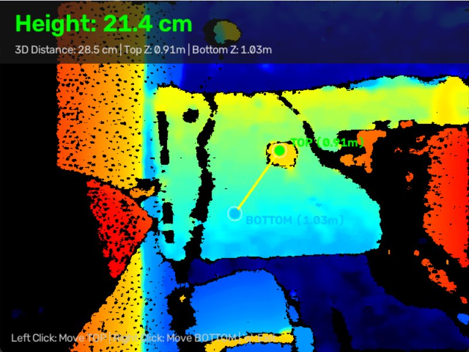

# Robot Depth Camera (Intel RealSense D455f)

비전 피킹 로봇(Vision Picking Robot) 시스템을 위한 Intel RealSense Depth Camera D455f 기반의 실시간 3차원 공간 좌표 역투영(Deprojection) 및 물체 치수(높이, 거리) 측정 시스템입니다.

---

## 1. 개요 (Overview)

본 프로젝트는 깊이(Depth) 센서의 원근 투영 왜곡을 수학적으로 보정하여, 카메라와의 거리에 종속되지 않는 절대 물리 치수(cm)를 실시간으로 측정하는 것을 목적으로 합니다. 로봇 매니퓰레이터의 비전 피킹 파이프라인에서 대상 물체의 크기 및 작업 공간 내 상대 거리를 신뢰도 높게 산출할 수 있습니다.

---

## 2. 측정 예시 (Example)



### 실측 데이터 분석
* **수직 물리 높이 (Height)**: **21.4 cm** (|ΔY| 축 기준)
* **3차원 직선 거리 (3D Distance)**: **28.5 cm** (유클리드 공간 거리 $\sqrt{\Delta X^2 + \Delta Y^2 + \Delta Z^2}$)
* **측정점 깊이 (Z-Depth)**: 상단(Top) 0.91 m / 하단(Bottom) 1.03 m

---

## 3. 핵심 기술 및 구현 특징 (Key Technical Features)

### 3.1. 2D-to-3D 공간 역투영 (Pin-hole Camera Inverse Projection)
카메라 렌즈의 고유 내부 파라미터(Intrinsics: $f_x, f_y, c_x, c_y$) 및 왜곡 계수를 활용하여 2D 이미지 좌표 $(u, v)$와 깊이값 $Z$를 3차원 카메라 좌표계 $(X, Y, Z)$로 변환합니다.

$$X = \frac{(u - c_x) \cdot Z}{f_x}$$

$$Y = \frac{(v - c_y) \cdot Z}{f_y}$$

### 3.2. 실시간 인터랙티브 측정 인터페이스
* 마우스 좌클릭 / 우클릭 입력을 통해 물체 상단 및 하단 경계점을 임의로 지정할 수 있습니다.
* 실시간 드로잉 엔진을 통해 두 지점 간의 측정선 및 거리 정보가 HUD(Head-Up Display) 형태로 오버레이됩니다.

### 3.3. 깊이 결측치 및 노이즈 저감 (Post-Processing Filters)
* **Spatial Filter (공간 필터)**: 에지 보존 스무딩을 수행하여 고주파 깊이 노이즈를 억제합니다.
* **Temporal Filter (시간 필터)**: 다중 프레임 간 가중 평균을 통해 시간축 플리커링 및 결측치를 보정합니다.
* **커널 기반 중간값 추출 (Median Filter)**: 단일 픽셀 노이즈로 인한 측정 튐 현상을 방지하기 위해 $5\times5$ 윈도우 영역의 중앙값(Median) 깊이를 채택합니다.

### 3.4. 하드웨어 대역폭 자동 적응 (USB Auto Adaptation)
* 연결된 인터페이스(USB 2.0 / USB 3.0)를 런타임에 자동 식별하여 최적의 해상도(640x480 또는 848x480 @ 30fps)로 스트림 파이프라인을 자동 구성합니다.

---

## 4. 디렉터리 구조 (Directory Structure)

```text
robot_depth_camera/
├── docs/
│   └── measure_example.jpg          # 3D 높이 측정 실제 실행 화면 예시
├── realsense_measure_height.py       # 실시간 3D 높이 및 유클리드 거리 측정 프로그램
├── realsense_viewer.py               # RealSense 하드웨어 진단 및 스트림 뷰어
├── run_measure_height.bat            # 높이 측정 원클릭 실행 스크립트 (Windows)
├── run_viewer.bat                    # 하드웨어 뷰어 원클릭 실행 스크립트 (Windows)
├── requirements.txt                  # Python 패키지 의존성 정의
├── .gitignore                        # Git 추적 제외 목록
└── README.md                         # 시스템 매뉴얼 및 기술 문서
```

---

## 5. 요구 사항 및 설치 (Requirements & Setup)

### 5.1. 환경 사양
* **OS**: Windows 10/11 또는 Linux (Ubuntu 20.04/22.04 LTS 권장)
* **Python**: 3.9 이상
* **하드웨어**: Intel RealSense D400 시리즈 (D455, D455f, D435, D435i 등)
  * *권장: 최대 대역폭 활용을 위한 USB 3.0(SuperSpeed) 인터페이스 연결*

### 5.2. 패키지 설치
```bash
pip install -r requirements.txt
```

---

## 6. 사용 방법 (Usage)

### Windows 배치 스크립트 실행
* **3D 높이 측정 도구 실행**: `run_measure_height.bat` 더블 클릭
* **카메라 진단 뷰어 실행**: `run_viewer.bat` 더블 클릭

### CLI 명령어 실행
```bash
# 실시간 3D 높이 측정 실행
python realsense_measure_height.py

# 하드웨어 통신 상태 및 뷰어 실행
python realsense_viewer.py
```

### 조작 단축키
* **마우스 좌클릭 (Left Click)**: 상단 측정점(TOP, 초록색) 이동
* **마우스 우클릭 (Right Click)**: 하단 측정점(BOTTOM, 하늘색) 이동
* **'q' 또는 'ESC'**: 프로그램 안전 종료

---

## 7. 참고 자료 (References)

* Intel RealSense SDK 2.0 공식 저장소: [https://github.com/realsenseai/librealsense](https://github.com/realsenseai/librealsense)
